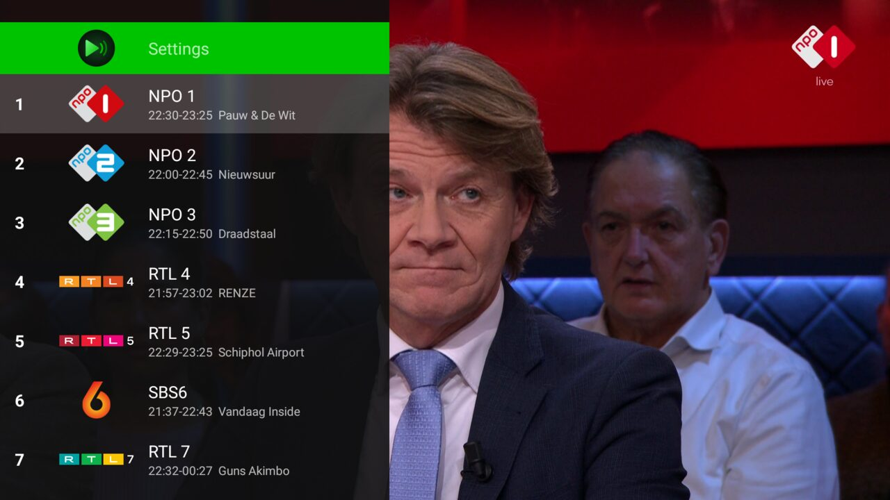
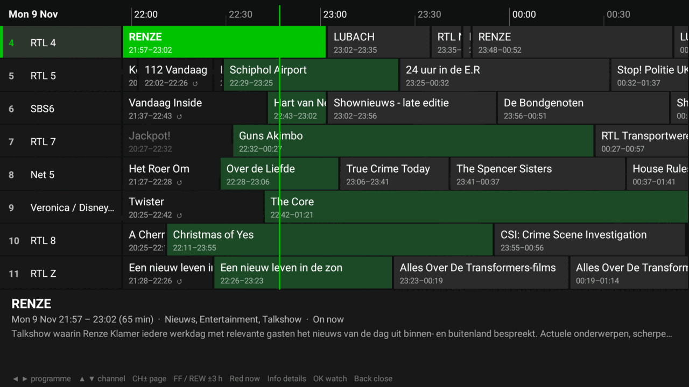
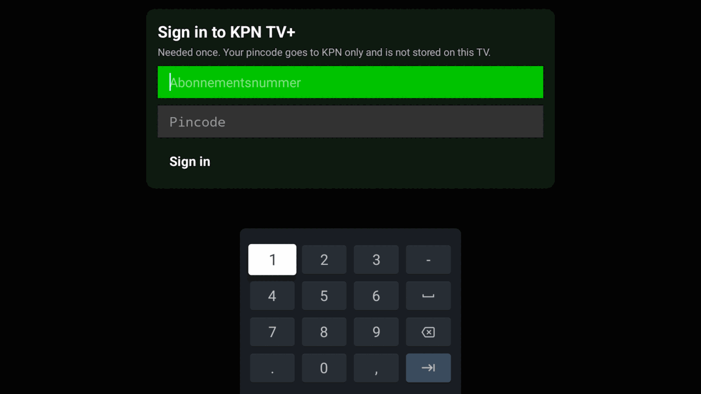
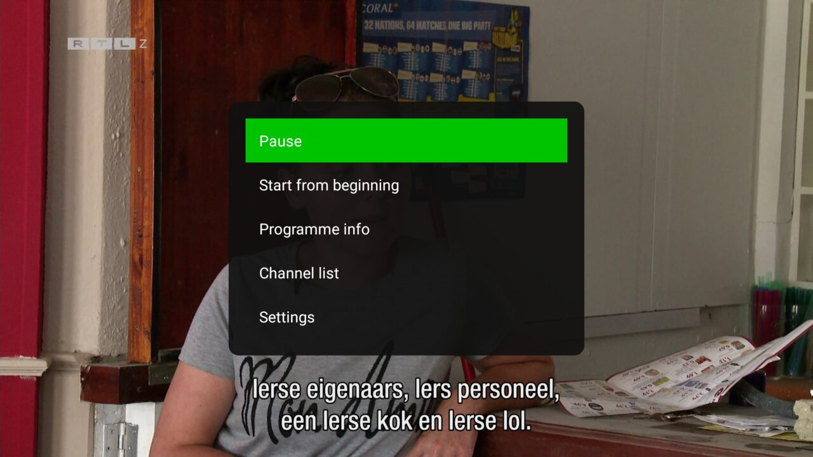
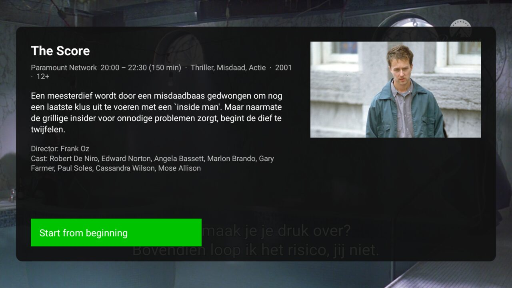
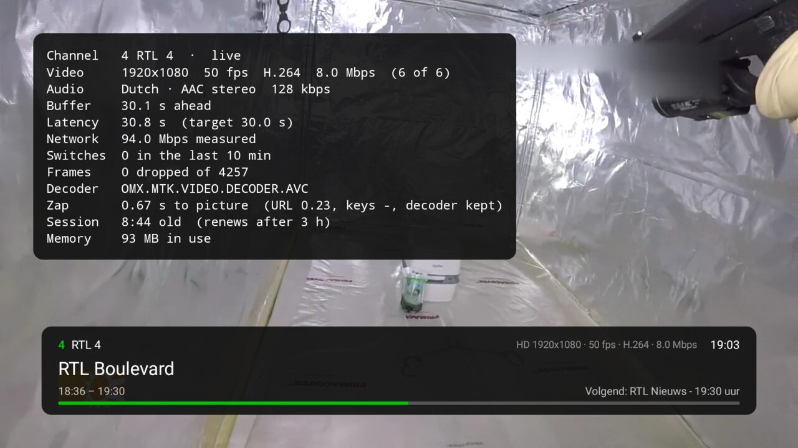
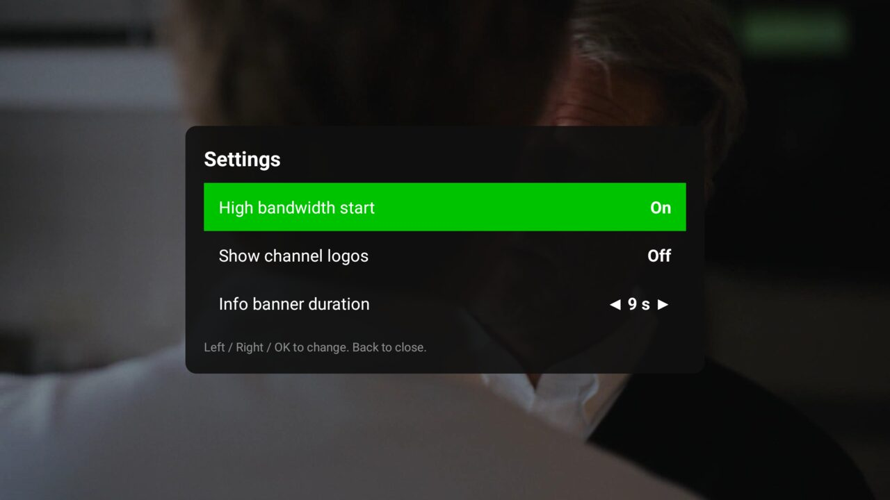

<p align="center">
  
</p>

# KPN Slim

A small, fast Android TV app that does one thing: **watch live KPN TV+ channels**.

No ads, no promotions, no menus you did not ask for. You press a channel key and the picture is there, in well under a second. The whole app is about 1.2 MB and sits around 90 MB of memory while playing, which makes a real difference on the modest chips inside many smart TVs.

> **Unofficial.** KPN Slim is an independent hobby project. It is not made, endorsed or supported by KPN. You need your own KPN TV+ subscription, and the app only plays what that subscription already gives you. See [Disclaimer](#disclaimer).

<p align="center">
  
</p>

## What you get

- **Live TV with fast zapping.** A zap takes about half a second. Hold the key and it steps through channels without stalling, and the last picture stays on screen until the next channel is ready, so there is no black flash.
- **Now and next on every channel,** in the channel list and in a banner that appears when you tune.
- **A full TV guide** for all channels, scrolling a week back and a week forward.
- **Start from the beginning** of the programme that is on now, and **watch earlier programmes** from the guide.
- **Pause live TV,** and rewind and fast forward with the media keys. The banner shows how far behind live you are.
- **Audio and subtitle choice** that is remembered across channels.
- **Programme info** with description, cast, genres and artwork.
- **Safe by default.** While you are not watching live, accidental channel changes need a second press, so a stray key does not throw away the programme you were rewinding.

<p align="center">
  
</p>

## Requirements

- An Android TV or Google TV device (Android 8.0 or newer).
- A **KPN TV+ subscription** and your **abonnementsnummer** and **pincode**.
- Basic comfort with installing an app outside the Play Store (sideloading). There is no store listing and no prebuilt download, so you build the APK yourself, see [For developers](#for-developers).

## Install

1. Build the APK (see [For developers](#for-developers)), or get one from someone you trust who built it from this source.
2. Put it on the TV. The easiest way is over the network with `adb`:
   ```sh
   adb connect <tv-ip>:5555
   adb install -r app-release.apk
   ```
   On the TV, enable **Developer options** and **USB/ADB debugging** first (Settings, About, tap the build number seven times).
3. Open **KPN Slim** from the apps row on your home screen.

## First start

The first time, the app asks you to sign in with your **abonnementsnummer** and **pincode**, the same ones you use for KPN TV+.

<p align="center">
  
</p>

- You only do this **once**. Your pincode goes to KPN and nothing else, and it is **not stored** on the TV.
- The app registers itself with your account as a device. After that it signs in on its own, even after updates.
- If KPN ever stops accepting the TV (for example after you removed the device from your KPN account), the sign-in screen simply comes back.

## Using the remote

| Key | What it does |
|---|---|
| **Up / Down**, **CH+ / CH-** | Next or previous channel |
| **0 to 9** | Type a channel number |
| **Last channel** | Back to the previous channel |
| **OK** | Options menu (pause, start from beginning, go to live, programme info, channel list, settings) |
| **Right** or **Info** | Show the info banner. Press again to open the options menu |
| **Left** or **Menu** | Channel list. Its first row opens Settings |
| **Guide** | TV guide |
| **Play / Pause** | Pause and resume |
| **Rewind / Fast forward** | Skip back or forward. Press repeatedly to skip further |
| **Stop** | Jump back to live |
| **Red** | Start the current programme from the beginning |
| **Green** | Programme info |
| **Yellow** | Audio and subtitles |
| **Blue** | Technical overlay (resolution, bitrate, buffer, zap time) |
| **Back** | Close what is open. With nothing open, press twice to exit |

In the **TV guide**: Left and Right move between programmes, Up and Down between channels, CH+ and CH- a page at a time, Fast forward and Rewind three hours, **Red** jumps back to now, **OK** watches the selected programme and **Info** shows details.

<table>
  <tr>
    <td></td>
    <td></td>
  </tr>
</table>

### The info banner and technical overlay

Tuning shows a banner with the channel, the programme, its time range, what is next and a progress bar. The green part is where you are; when you are behind live, the grey part up to the live point is shown too. The **Blue** key adds an overlay for the curious: video format, bitrate, buffer, how long the last zap took and memory use.

<p align="center">
  
</p>

## Settings

Open them from the first row of the channel list or from the options menu.

<p align="center">
  
</p>

- **High bandwidth start.** Starts playback straight at full quality instead of ramping up from a blurry picture. Worth switching on with a good connection.
- **Show channel logos.** Logos in the channel list and banner, on or off.
- **Info banner duration.** How long the banner stays, 1 to 15 seconds.

## Questions

**What happens if I type a wrong pincode?** KPN's message appears in red under the fields. Fix the entry and press Sign in again.

**How do I sign out or switch accounts?** There is no sign-out row yet. Clear the app's data in Android's app settings (Settings, Apps, KPN Slim, Clear data) and the sign-in appears again.

**Does it use extra devices on my account?** Yes, it registers as one device when you sign in. Every time you clear the app data and sign in again it registers another one, so avoid doing that often.

**Why is there no recording, on demand or casting?** On purpose. The goal is a lean live-TV viewer. Those features are what make the official app heavy.

**Can it stop working?** Yes. It relies on KPN's service behaving as it does today, and KPN can change that at any time.

## Disclaimer

KPN Slim is unofficial and unaffiliated. "KPN" and "KPN TV+" are trademarks of their owner, and I use them only to say which service the app works with. Use of the service is governed by KPN's own terms and conditions, and it is your responsibility to make sure your use of this app fits them. The app does not bypass DRM or any access control: it signs in with your own subscription and plays your own channels. It comes **as is, without warranty**, and the programme images in the screenshots belong to their broadcasters.

---

## For developers

Native Kotlin, no framework beyond the essentials: Media3 ExoPlayer (DASH with Widevine) for playback, `HttpURLConnection` and `org.json` for the service calls, plain Android views. No Flutter, Firebase or image library.

### Build

You need JDK 21 and the Android SDK (compile SDK 36, minimum 26).

```sh
cd android
cp gradle.properties.example gradle.properties   # then set org.gradle.java.home to your JDK 21
./gradlew assembleRelease
```

The release build is signed with the local debug key so it can be sideloaded straight away. The result is `android/app/build/outputs/apk/release/app-release.apk`. `android/install.sh [device]` installs it, compiles it ahead of time (faster first start) and launches it.

`gradle.properties` is git-ignored. It can optionally hold `kpn.account` and `kpn.deviceId` to skip the sign-in on a device you have already registered. Leave them out for a normal build.

### Code map

All code is in `android/app/src/main/java/nl/kpn/slim/`.

| File | Role |
|---|---|
| `MainActivity.kt` | UI, playback, zapping, overlays, remote keys |
| `AvsClient.kt` | The HTTP client for the TV service: sign-in, session, channels, play URLs, guide |
| `Epg.kt` | In-memory guide data |
| `GuideView.kt` | The TV guide grid, drawn on one canvas |
| `ChannelAdapter.kt`, `LogoLoader.kt` | Channel list and small image loader |
| `Identity.kt` | The stored account and device identity |

### More documentation

- [`NEXT_STEPS.md`](NEXT_STEPS.md): project state, behaviour details, gotchas and the roadmap. Read it before changing anything.
- [`API_CONTRACT.md`](API_CONTRACT.md): the exact HTTP calls the app makes.
- `android/art/make_art.py` generates the icon and banner. Edit its constants, not the generated files.

Ideas on the roadmap: sign-out and device cleanup, a seek bar with thumbnails, favourites, search and reminders.
